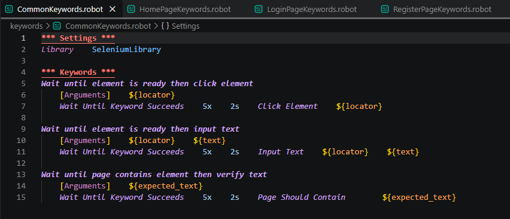
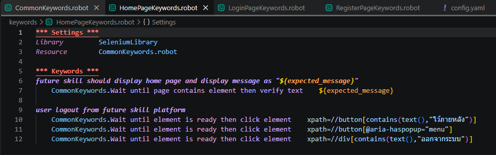
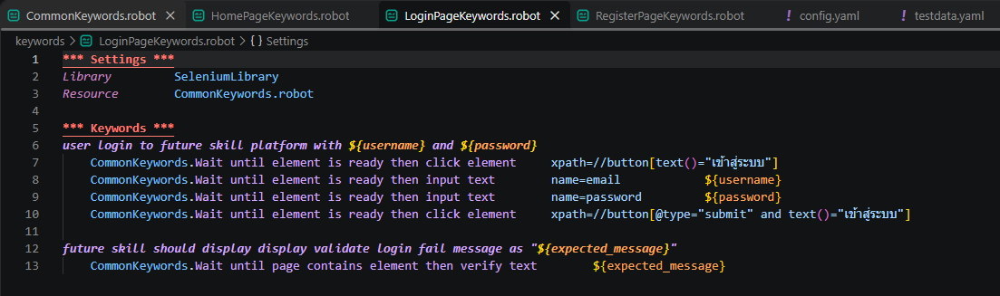
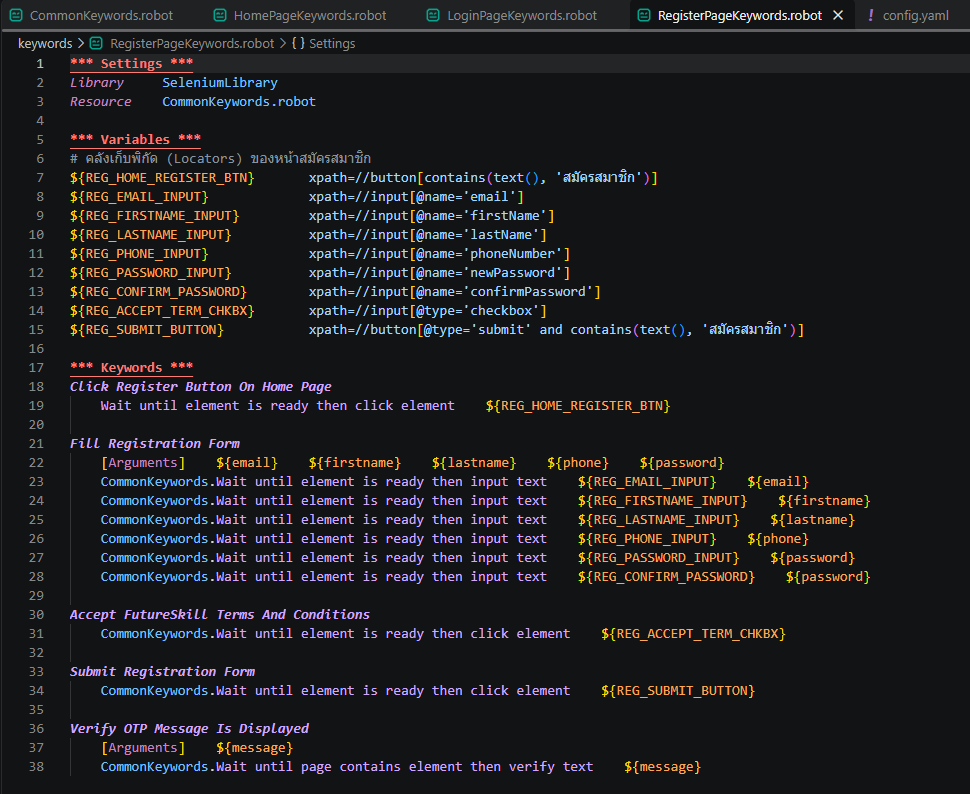
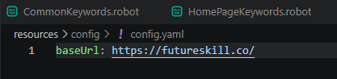
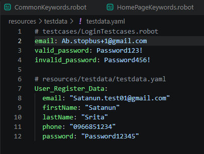
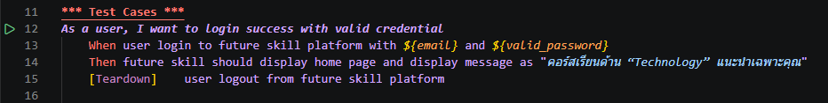
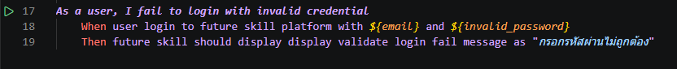
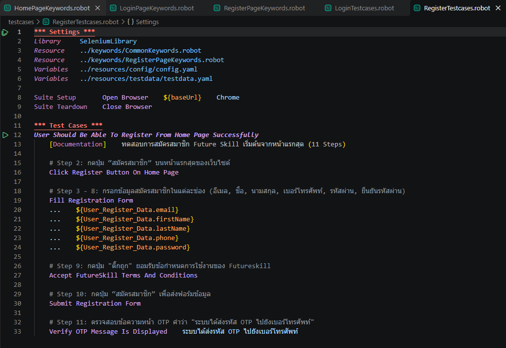

## 🚀 ทดสอบระบบ FutureSkill ด้วย Robot Framework และ SeleniumLibrary
Class Project: การทดสอบระบบอัตโนมัติ (Automated Testing) บนเว็บไซต์ [FutureSkill](https://futureskill.co/) โดยใช้เครื่องมือ **Robot Framework และ SeleniumLibrary** ตามหลักการ **Page Object Model (POM)** เพื่อออกแบบและจัดการโครงสร้างของ Element Locators, Reusable Keywords และ Test Scenarios ได้อย่างชัดเจน เหมาะสมกับการบำรุงรักษาและนำกลับมาทดสอบซ้ำ ดังนี้

## 📁 Project Structure

```text
Test-Script-Robot-Framework/
├── keywords/                       # แหล่งรวม Custom Keywords แยกตามหน้างาน (Page Keywords & Common Keywords)
│   ├── CommonKeywords.robot        # Keyword สำหรับจัดการ Action พื้นฐาน (Click, Input, Verify)
│   ├── HomePageKeywords.robot      # Keyword สำหรับจัดการ Element/Action หน้า HomePage & Logout
│   ├── LoginPageKeywords.robot     # Keyword สำหรับการ Login และ Validation
│   └── RegisterPageKeywords.robot  # Keyword สำหรับการสมัครสมาชิก
├── resources/                      # แหล่งเก็บข้อมูล Configuration และ Test Data
│   ├── config/
│   │   └── config.yaml             # URL และค่าการตั้งค่าสภาพแวดล้อมระบบ (Environment Configuration)
│   └── testdata/
│       └── testdata.yaml           # ข้อมูลที่ใช้ในการทดสอบ (Test Data เช่น Credentials, Register Info)
├── results/                        # โฟลเดอร์เก็บ Report และ Screenshot จากการรัน Test
│   ├── Login/                      # ผลการทดสอบ ชุด Login
│   └── Register/                   # ผลการทดสอบ ชุด Register
└── testcases/                      # สคริปต์เคสการทดสอบหลัก (Test Suite / Scenarios)
    ├── LoginTestcases.robot        # Test Scenarios การเข้าสู่ระบบ (Pass/Fail Cases)
    └── RegisterTestcases.robot     # Test Scenarios การสมัครสมาชิก
```

---

## 🛠️ Tools & Technologies
* **Programming / Scripting Language:** Python Version 3.0 ขึ้นไป
* **Test Automation Framework:** Robot Framework
* **Library:** SeleniumLibrary (สำหรับทำ Web Browser Automation)
* **Design Pattern:** Page Object Model (POM)
* **Data Format:** YAML (config.yaml, testdata.yaml)

---

## ⚙️ Key Concepts & Architecture

### 1.Common Keywords (keywords/CommonKeywords.robot)
เป็นไฟล์ Keyword และเลือกใช้คำสั่งพื้นฐาน Wait Until Keyword Succeeds ของ SeleniumLibrary เพื่อป้องกันไม่ให้เกิดปัญหา Flaky Tests จากการโหลดหน้าเว็บไม่ทัน:

* **Wait until element is ready then click element:** รอจนกว่า Element จะพร้อมใช้งานแล้วจึงคลิก
* **Wait until element is ready then input text:** รอจนกว่า Element จะพร้อมแล้วจึงพิมพ์ข้อความ
* **Wait until page contains element then verify text:** ตรวจสอบข้อความบนหน้าเว็บตามที่คาดหวัง

<div align="center">

</div>

---

### 2.Page Keywords (keywords/PageKeywords.robot)
เป็น Keyword เฉพาะของแต่ละหน้า เช่น HomePage, Login และ Register

* **HomePageKeywords.robot**
HomePageKeywords.robot: ตรวจสอบการแสดงผลหน้าแรก และฟังก์ชันการออกจากระบบ (Logout)

<div align="center">

</div>

* **LoginPageKeywords.robot**
LoginPageKeywords.robot: ขั้นตอนการกดปุ่มเข้าสู่ระบบ, กรอก Username/Password และตรวจสอบความถูกต้องของ Error Message

<div align="center">

</div>

* **RegisterPageKeywords.robot**
RegisterPageKeywords.robot: รวบรวม Locators ของฟอร์มสมัครสมาชิก และ Keyword ในการกรอกข้อมูลสมัครสมาชิก รวมถึงการยืนยันข้อความ OTP

<div align="center">

</div>

---

### 3.Configuration & Test Data Driven (resources/config.yaml)
แยกข้อมูลที่ใช้ทดสอบออกจากสคริปต์เพื่อรองรับ Data-Driven Testing

* **config.yaml**
นำลิงค์ของเว็บไซต์ที่ทดสอบมาเก็บไว้และใช้ค่า baseUrl แทน

<div align="center">

</div>

* **testdata.yaml**
เก็บข้อมูลบัญชีผู้ใช้งานสำหรับ Login เข้าสู่ระบบและชุดข้อมูลสมัครสมาชิก เช่น อีเมล, ชื่อ-นามสกุล, เบอร์โทรศัพท์ และรหัสผ่าน

<div align="center">

</div>

---

## 🧪 Test Coverage & Scenarios

### 1.Login Test Suite (testcases/LoginTestcases.robot)

* **Pass Case:** As a user, I want to login success with valid credential

   * กรอก Username และ Password ที่ถูกต้อง
   * ตรวจสอบว่าระบบได้พาไปยัง หน้าหลัก และมีการแสดงข้อความ "คอร์สเรียนด้าน “Technology” แนะนำเฉพาะคุณ" ได้ถูกต้อง
   * ทำการ Logout เมื่อจบการทดสอบ

<div align="center">

</div>

* **Fail Case:** As a user, I fail to login with invalid credential

   * กรอก Username หรือ Password ไม่ถูกต้อง
   * ตรวจสอบว่าระบบแสดงข้อความแจ้งเตือนความผิดพลาด เช่น "กรอกรหัสผ่านไม่ถูกต้อง"

<div align="center">

</div>

---

### 2.Registration Test Suite (testcases/RegisterTestcases.robot)

* **Pass Case:** User Should Be Able To Register From Home Page Successfully

   * กดปุ่ม "สมัครสมาชิก" บนหน้าแรก
   * กรอกข้อมูลลงแบบฟอร์มสมัครสมาชิก (อีเมล, ชื่อ, นามสกุล, เบอร์โทรศัพท์, รหัสผ่าน)
   * กด "ยอมรับเงื่อนไขบริการ" และกด "ยืนยันการสมัคร"
   * ตรวจสอบข้อความแจ้งเตือนหน้า OTP "ระบบได้ส่งรหัส OTP ไปยังเบอร์โทรศัพท์"

<div align="center">

</div>

---

## 🚀 How to Run the Tests

### 1.Prerequisites & Installation
เปิด Terminal / Command Prompt แล้วทำการติดตั้ง Library ที่จำเป็น

#### ติดตั้ง Robot Framework และ SeleniumLibrary

* pip install robotframework robotframework-seleniumlibrary

#### ติดตั้ง Library สำหรับอ่านไฟล์ YAML

* pip install pyyaml

---

### 2. Run Test Suites
สามารถเลือกคำสั่งรัน Test Suite และกำหนดโฟลเดอร์สำหรับเก็บผลลัพธ์ (Report/Log) ได้ดังนี้

#### ชุดคำสั่งการทดสอบหน้า Login

* robot -d results/Login testcases/LoginTestcases.robot

#### ชุดคำสั่งการทดสอบหน้า Register

* robot -d results/Register testcases/RegisterTestcases.robot

#### รันเคสการทดสอบทั้งหมดในโปรเจกต์

* robot -d results testcases/

---

## 📊 Test Reports & Screenshots
หลังจากรันสคริปต์การทดสอบเสร็จสิ้น Robot Framework จะสร้างไฟล์สรุปผลและภาพบันทึกหน้าจอโดยอัตโนมัติ โดยระบบจะทำการจัดเก็บไฟล์แยกตามโฟลเดอร์โมดูล ดังนี้

### ผลการทดสอบ
#### 1.หน้า Login (results/Login/)


#### 2.หน้า Register (results/Register/)


